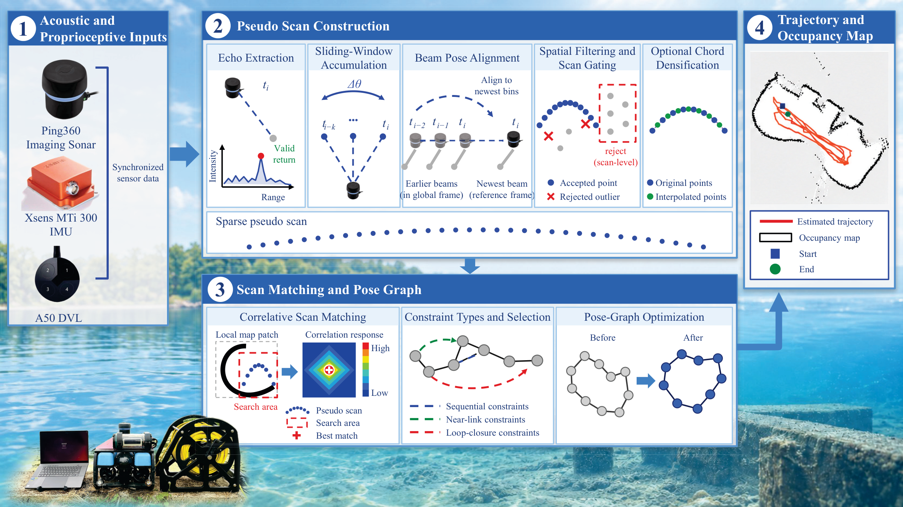

# Ping-SLAM

This repository contains the ROS 2 implementation used for the Ping-SLAM
paper. It includes the sonar front end, the Karto/Ceres pose-graph back end,
launch files, dataset parameters, and experiment scripts.



**Figure 1. Ping-SLAM system overview.** Sonar and proprioceptive sensors feed
pseudo scan construction and scan matching with pose-graph optimization,
which produce the trajectory and sonar map.

**Project website:** https://ymiemie95.github.io/ping-slam/

Sonar bags, motion-capture ground truth, large experiment archives, and the
manuscript source are not stored here. Obtain them separately and set the
paths described in [`REPRODUCE.md`](REPRODUCE.md).

## Requirements

The reference environment is Ubuntu 20.04 with ROS 2 Foxy. The build also
needs Eigen3, Ceres, SuiteSparse/CSparse/Cholmod, Boost, TBB, LAPACK,
Python 3, NumPy, and `evo`. The custom ROS message
packages under `src/datasetMessageDefinitions` are part of this workspace.
See [`dependencies/README.md`](dependencies/README.md).

## Build

```bash
source /opt/ros/foxy/setup.bash
rosdep update
rosdep install --from-paths src --ignore-src -r -y
colcon build --symlink-install --cmake-args -DBUILD_TESTING=OFF
source install/setup.bash
```

## Run

From the workspace root, activate the dataset's three configuration files
(P6 below; this replaces the active YAML files):

```bash
source /opt/ros/foxy/setup.bash
source install/setup.bash
python3 scripts/select_dataset.py P6
ros2 launch launch/full_slam_run.py
# In another terminal, source ROS and install/setup.bash, then:
ros2 bag play /path/to/P6_DataSet06
```

The launch file runs the EKF, sonar-to-laser conversion, and Ping-SLAM back
end. `config/paperView.rviz` and the optional visualizer/recolor nodes are for
visualization and video recording, not for the estimator itself.
RViz is disabled by default. Enable `LAUNCH_RVIZ` in the launch file for
interactive visualization. The reference Foxy rosbag CLI does not support `--clock`.

## Paper results

The experiment harness uses Docker and exports optimized trajectories and maps
after the bag has finished:

```bash
export PING_SLAM_HOST_ROOT="$PWD"
export PING_SLAM_CONTAINER_ROOT=/root/codes/ping_slam_ws
export PING_SLAM_CONTAINER=scan_slam_foxy
export PING_SLAM_DATA_ROOT=/root/codes/ping_slam_ws/data
export PING_SLAM_GT_ROOT=/root/codes/ping_slam_ws/recordresults/comparative

python3 scripts/select_dataset.py P6
bash tuning/tune_run.sh release_P6 1 P6
bash tuning/evaluate.sh release_P6 P6 release-check
```

Generated runs belong in the ignored `tuning_runs/` directory. See
[`REPRODUCE.md`](REPRODUCE.md) for the complete workflow.
The Docker container must already be running with the workspace and datasets
mounted at the declared paths. Use a dedicated container: cleanup operates
across that container, not just within one ROS domain.

## Layout

```text
src/          ROS 2 packages and message definitions
config/       runtime parameters
launch/       ROS 2 launch files
scripts/      visualization and map/trajectory utilities
tuning/       experiment and evaluation harnesses
dependencies/ clean-machine dependency notes
```

Experimental bags, generated maps, build products, tuning archives, and raw
videos are intentionally ignored by Git.

## License

Packages retain their own licenses and third-party notices. The front end is
BSD-3-Clause and includes an EKF derived from the upstream underwater SLAM
project. The backend is derived from slam_toolbox and retains its LGPL-2.1
license, separate Karto LGPL-3.0-or-later headers and other file notices.
Read each package's `LICENSE` and `NOTICE`, together with [`NOTICE.md`](NOTICE.md),
for the component attribution and license details.
